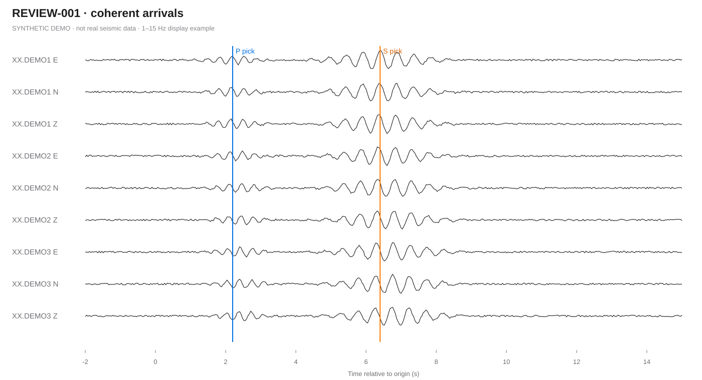

# Waveform Review Kit

[简体中文](README.md) · **English**

A lightweight, local-first tool for reviewing **pre-rendered seismic waveform figures** and recording reproducible human quality-control decisions.

Waveform Review Kit separates the review interface from the scientific processing pipeline. Researchers can keep using their own SAC/miniSEED readers, filtering, phase picks and plotting conventions, then review the resulting images in a browser. **This tool does not locate earthquakes, pick phases, or process raw waveform files.**

## What it does

- Browse multi-station, multi-page waveform figures with keyboard navigation.
- Compare review candidates against read-only reference sections.
- Filter by event ID, tags, metadata and review decision.
- Assign configurable decisions and optional notes.
- Save decisions automatically in the **current browser's localStorage**.
- Export decisions as CSV and import a previous export to resume work.
- Serve everything on `127.0.0.1` by default, using only Python's standard library.

**Current limitations:** the interface labels are primarily in Chinese; the browser is the temporary source of truth until you export; the app is not a synchronized multi-user database. Real SAC, miniSEED and other seismic waveforms must be rendered into images first.

## Quick start

**Requirements:** Python 3.10+; a recent browser. No third-party Python packages are needed to run the application.

```bash
git clone https://github.com/yun601291-tech/waveform-review-kit.git
cd waveform-review-kit
python app.py --project examples/demo --open
```

Open <http://127.0.0.1:8765/> if your browser does not open automatically. Stop the server with `Ctrl+C`.

Windows users can double-click `run_demo_windows.bat`. On macOS/Linux, run `./run_demo_mac_linux.sh` after `chmod +x run_demo_mac_linux.sh`.

The bundled examples are **synthetically generated** and contain no real seismic traces or station data.

### Synthetic waveform example



*An example input image rendered by the demo. This is not a real seismogram or an application screenshot.* To capture a **real screenshot of the running interface**, see [Capturing the demo](#capture-an-authentic-app-screenshot).

## Build a review project from your own figures

1. Render waveform pages to PNG, JPEG, SVG or WebP with your usual plotting tools.
2. Create a UTF-8 CSV with at least `id` and `image` (or `images`) columns.
3. Generate a standalone project directory:

```bash
python tools/build_project.py \
  --csv examples/sample_input.csv \
  --assets-root examples \
  --output /tmp/waveform-review-example \
  --title "My waveform QC" \
  --project-id my-waveform-qc
python app.py --project /tmp/waveform-review-example --open
```

On Windows, replace `/tmp/waveform-review-example` with a suitable local directory, for example `C:\\waveform-review-example`.

Each CSV row corresponds to one item. Supported columns include:

| Column | Meaning |
| --- | --- |
| `id` | Unique identifier (required) |
| `image` or `images` | Image path(s) relative to `--assets-root`, separated with `|` |
| `section` | Group; defaults to `review` |
| `title`, `subtitle` | Display text |
| `tags` | Tags separated with `|` |
| `page_labels` | Labels for multiple waveform pages, separated with `|` |
| `meta_*` | Any additional searchable metadata column |

By default, sections named `known` and `candidate` are read-only references; others are reviewable. Override these using `--reference-sections`. Edit the generated `project.json` to adjust labels and shortcuts.

The builder refuses to overwrite an existing project unless you explicitly pass `--overwrite`. Keep a backup of `project.json` and your source images.

## Review workflow

1. Review known/reference examples to establish criteria.
2. Switch to the review section and inspect every available waveform page.
3. Use **left/right arrows** for items, **[ / ]** for pages, **1–4** for the demo decisions, and **0** to clear a decision.
4. Add notes explaining ambiguous picks, noise, inconsistent arrivals or other concerns.
5. **Export CSV regularly**, especially before clearing browser data or moving to another computer.

Decision codes are defined by the project manifest; the example uses `confirmed`, `possible`, `rejected` and `uncertain`. The exported CSV includes item IDs, decision codes, notes, timestamps and metadata. The importer matches item IDs in the *currently loaded project*. Verify that IDs and definitions are stable before importing older results.

### Data security and privacy

- The HTTP server is read-only, and the default bind address is localhost.
- Images and decisions are not sent to a hosted service by the application.
- Decisions and notes live in the current browser's localStorage until you export.
- Binding to `0.0.0.0` exposes the server to other devices on the network; avoid doing that with sensitive data.
- Do **not** commit real seismic datasets, station identifiers or private review exports. The public demo uses generated figures only.

## Tests

Run the dependency-free test suite:

```bash
python -m unittest discover -s tests -v
```

GitHub Actions runs the tests for supported Python versions and produces an **authentic browser screenshot** of the synthetic demo as a downloadable CI artifact when the screenshot job succeeds.

## Capture an authentic app screenshot

Screenshot generation is optional and requires Playwright *only for this task*:

```bash
python -m pip install playwright
python -m playwright install chromium
python tools/capture_demo.py --output demo-screenshot.png
```

The script launches the bundled synthetic demo on a temporary localhost port and captures the actual rendered browser UI. It never uses private datasets. Do not present the synthetic data as real earthquake observations. PNG files are ignored by Git by default; check the image for private information before adding one to a repository.

## Contributing

Issues, reproducible bug reports and small pull requests are welcome. See [CONTRIBUTING.md](CONTRIBUTING.md) for tests, data-handling rules and development workflow.

## License

MIT — see [LICENSE](LICENSE).